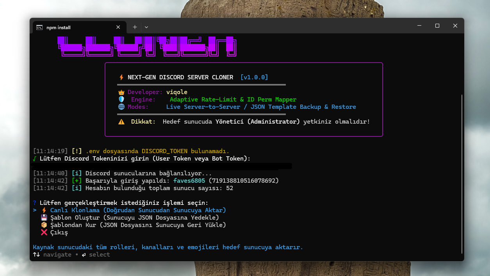
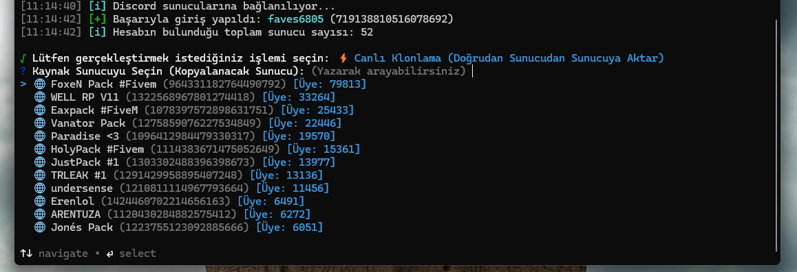
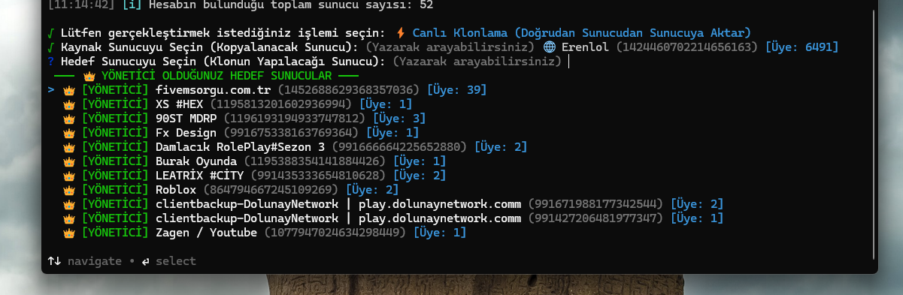
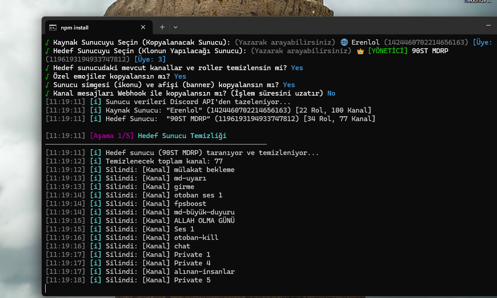

<div align="center">

# ⚡ Viqole Discord Server Cloner

**Next-Gen Ultra Fast, Reliable & Hierarchy-Preserving Discord Server Cloner & Template Engine**

[-00b159?style=for-the-badge&logo=virustotal&logoColor=white)](https://www.virustotal.com/gui/file/27248c71a2f14594229669ec5a9c74c887087f5f3ccd9897418d77ccef240e48?nocache=1)
[](https://opensource.org/licenses/MIT)
[](https://nodejs.org/)
[](https://discord.com)
[](https://github.com/ViqoleBoneless/Discord-Server-Cloner)

<p align="center">
  <b>Developer:</b> <a href="https://github.com/ViqoleBoneless">viqole</a> &bull; 
  <b>Version:</b> <code>1.0.0</code> &bull; 
  <b>Architecture:</b> Adaptive Rate-Limit & Smart ID Perm Mapper
</p>

<p align="center">
  <a href="README.md">🇹🇷 Türkçe Dokümantasyon</a> &bull;
  <a href="README.en.md">🇬🇧 English Documentation</a>
</p>

</div>

---

## 📸 Screenshots & Showcase

<div align="center">

### 🖥️ 1. Main Menu & Viqole Neon Terminal Interface


### 🔍 2. Real-Time Interactive Server Search


### 👑 3. Administrator Servers Highlighted at the Top


### ⚡ 4. Target Server Cleanup & Live Cloning Process


</div>

---

## 🌟 Key Features

* **👑 Smart ID Permission Mapper:**  
  Roles and channel permissions are mapped via direct `Map<sourceRoleId, targetRoleId>` IDs rather than fragile names. Duplicate names or decorative separator roles (`---`, `★`) will never clash or lose permissions.
* **🛡️ 429 Adaptive Rate-Limit Backoff:**  
  Whenever Discord triggers an HTTP 429 Too Many Requests response, the cloner automatically intercepts the `retry-after` header, sleeps safely, and resumes without crashing.
* **📐 Perfect Role Hierarchy & Position Order:**  
  Discord creates new roles at position 1 (just above `@everyone`), which inverts roles in other cloners. Viqole Cloner creates roles in descending order and locks the final hierarchy using Discord's official batch `roles.setPositions` API.
* **🔍 Real-Time Type-Ahead Search:**  
  Instantly filter through hundreds of servers by typing server names or IDs directly into your terminal.
* **👑 Admin Target Priority:**  
  Target server selection automatically detects guilds where you hold **Administrator** or **Server Owner** privileges, sorting them with green `👑 [ADMIN]` tags at the very top.
* **🔑 Smart Token Sanitizer:**  
  Accidentally copied wrapping quotes (`"..."`, `'...'`, or backticks) from browser DevTools? The cloner automatically strips them and logs in seamlessly.
* **🌐 Multi-Language Support (TR / EN):**  
  Switch on the fly between English and Turkish via the interactive terminal menu.
* **💾 Dual Modes (Live & Template):**  
  Clone directly server-to-server, or export any Discord server into a standalone, portable **JSON template** in `./backups/` to restore anytime.
* **📨 Webhook Message Cloning:**  
  Optionally transfer recent channel messages preserving the original author's avatar, display name, and embeds.

---

## 📊 Comparison Table

| Feature | Other Cloners | Viqole Cloner |
| :--- | :---: | :---: |
| **Role Perm Mapping** | Fragile name-matching (breaks on duplicates) | **`Map<OldID, NewID>` Exact Mapping** |
| **Role Hierarchy** | Inverted or randomly shuffled | **Descending Creation + Batch `setPositions`** |
| **Rate Limit (429) Handling** | Crashes or triggers Cloudflare blocks | **Adaptive Auto-Backoff & Retry** |
| **Target Server Sorting** | Random order | **Admin Guilds Listed First** |
| **Server Search** | None (manual scrolling) | **Real-Time Type-Ahead Search** |
| **Templates (JSON)** | Missing or corrupted | **Clean, Portable JSON Backup & Restore** |
| **Windows Launcher** | Complex CMD or missing | **One-Click `start.bat` Script** |

---

## 🚀 Quick Start

### Method 1: One-Click Launcher (`start.bat` - Recommended for Windows)
1. Download the repository and enter the directory.
2. Double click **`start.bat`**.  
   *(Automatically checks Node.js, installs dependencies if missing, sets UTF-8 console encoding, and opens the interactive menu).*

### Method 2: Terminal / Command Prompt
```bash
# Install dependencies
npm install

# Start the cloner
npm start
```

---

## ⚙️ Configuration

Don't want to type your token every time? Rename `.env.example` to `.env` in the root folder and add your token:

```env
DISCORD_TOKEN=YOUR_DISCORD_TOKEN_HERE
LANGUAGE=en
```
> **Note:** Supports both **User (Selfbot) Tokens** and official **Bot Tokens**.

---

## 📁 Directory Architecture

```
Discord-Server-Cloner/
├── assets/                    # Screenshots and preview media
├── backups/                   # Exported JSON server templates
├── src/
│   ├── core/
│   │   ├── cloner.js          # Direct server-to-server orchestrator
│   │   ├── backup.js          # JSON template generator
│   │   ├── restore.js         # JSON template restore engine
│   │   └── rateLimiter.js     # Adaptive rate limiter and 429 backoff
│   ├── handlers/
│   │   ├── roles.js           # Role creation, hierarchy & ID mapping
│   │   ├── channels.js        # Categories, text, voice & news channels
│   │   ├── emojis.js          # Safe custom emoji transfer
│   │   ├── messages.js        # Webhook message cloning with avatar spoofing
│   │   └── guild.js           # Icon, banner & reliable target server cleanup
│   ├── i18n/
│   │   └── index.js           # Turkish & English localization dictionaries
│   ├── ui/
│   │   ├── banner.js          # Neon terminal welcome banner
│   │   ├── prompts.js         # Searchable, admin-first interactive menus
│   │   └── logger.js          # Colorized logs & structured stats report
│   └── index.js               # Main CLI launcher
├── start.bat                  # One-click Windows batch launcher
├── .env.example               # Configuration template
├── package.json               # Package dependencies and metadata
├── README.md                  # Turkish documentation
└── README.en.md               # English documentation
```

---

## 🛡️ Security & Disclaimer

- You must have **Administrator** or **Manage Server / Roles / Channels** permissions on the target server to create elements and assign permissions.
- Automated actions on Discord user accounts (Selfbots) can be subject to Discord's Terms of Service. This tool is built for server management, migration, and educational purposes. Use responsibly.
- You can verify the clean security audit on [VirusTotal (0/64 Clean)](https://www.virustotal.com/gui/file/27248c71a2f14594229669ec5a9c74c887087f5f3ccd9897418d77ccef240e48?nocache=1).

---

## 👑 Credits & License

Designed and developed by **viqole**.  
License: [MIT License](LICENSE) &bull; Feel free to star (⭐) and fork the repository!
