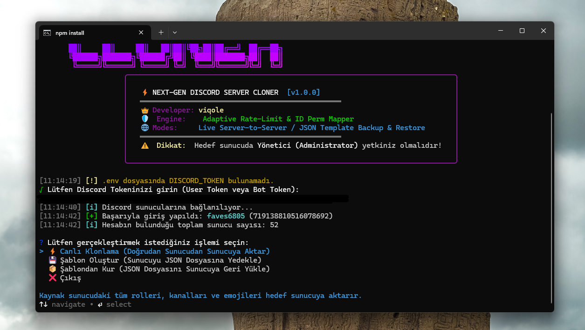
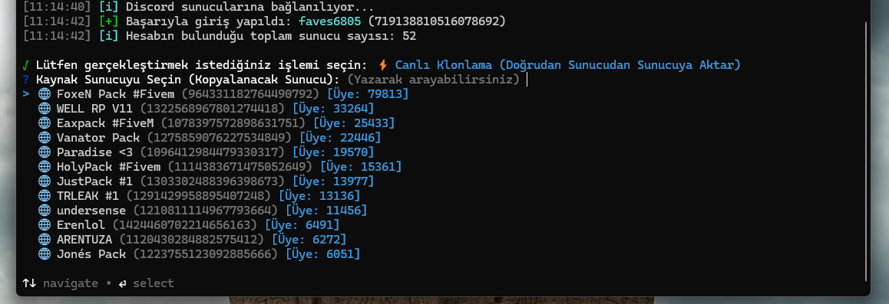
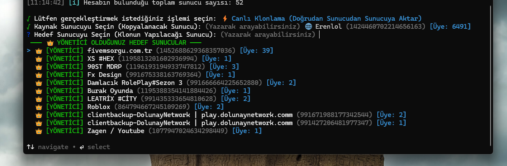
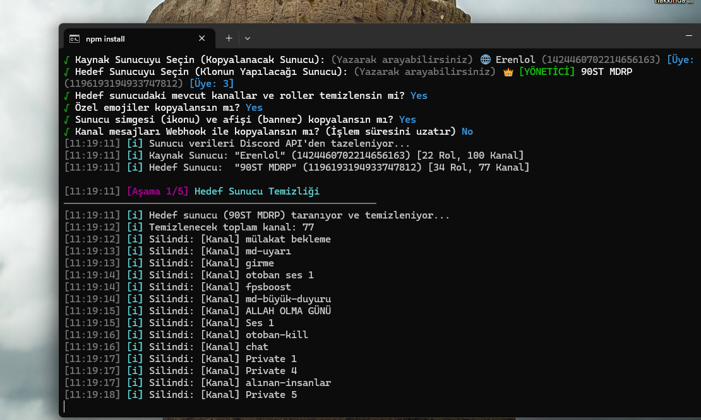

<div align="center">

# ⚡ Viqole Discord Server Cloner

**Yeni Nesil Ultra Hızlı, Güvenli ve Hiyerarşi Korumalı Discord Sunucu Klonlama & Şablon Aracı**

[-00b159?style=for-the-badge&logo=virustotal&logoColor=white)](https://www.virustotal.com/gui/file/27248c71a2f14594229669ec5a9c74c887087f5f3ccd9897418d77ccef240e48?nocache=1)
[](https://opensource.org/licenses/MIT)
[](https://nodejs.org/)
[](https://discord.com)
[](https://github.com/ViqoleBoneless/Discord-Server-Cloner)

<p align="center">
  <b>Geliştirici:</b> <a href="https://github.com/ViqoleBoneless">viqole</a> &bull; 
  <b>Sürüm:</b> <code>1.0.0</code> &bull; 
  <b>Mimari:</b> Adaptive Rate-Limit & Smart ID Perm Mapper
</p>

</div>

---

## 📸 Ekran Görüntüleri & Önizleme

<div align="center">

### 🖥️ 1. Ana Menü & Viqole Neon Terminal Arayüzü


### 🔍 2. Canlı Yazarak Sunucu Arama


### 👑 3. Yönetici Olunan Hedef Sunucular En Üstte


### ⚡ 4. Temizlik & Canlı Klonlama Aşaması


</div>

---

## 🌟 Öne Çıkan Özellikler

* **👑 Akıllı ID Haritalaması (Smart ID Perm Mapper):**  
  Roller isme göre değil, `Map<sourceRoleId, targetRoleId>` ile birebir kimliklerine göre eşlenir. Aynı isimdeki ayraç veya süs rolleri (`---`, `★`) asla birbirine karışmaz.
* **🛡️ 429 Adaptive Rate-Limit Koruması:**  
  Discord API hız sınırı verdiğinde program asla çökmez. Discord'un talep ettiği süre kadar dinamik duraklar ve kaldığı yerden otomatik devam eder.
* **📐 Kusursuz Rol Hiyerarşisi:**  
  Discord'un yeni rolleri en alta (1. pozisyona) ekleme algoritması tersine çevrilerek azalan sırada inşa edilir ve işlem sonunda resmi `roles.setPositions` toplu API'si ile kaynak sunucuyla milimetrik olarak eşitlenir.
* **🔍 Canlı Arama (Real-Time Search):**  
  Sunucu seçimi ekranında klavyeden sunucunun adını veya ID'sini yazarak yüzlerce sunucu arasından anında arama yapabilirsiniz.
* **👑 Yönetici Sunucu Önceliği:**  
  Hedef sunucu seçerken yetkinizin olduğu (**Yönetici / Sunucu Sahibi**) sunucular otomatik tespit edilir ve yeşil etiketle listenin en tepesinde gösterilir.
* **🔑 Akıllı Token Temizleyici:**  
  Tokeni kopyalarken yanlışlıkla başındaki ve sonundaki tırnak işaretlerini (`"..."` veya `'...'`) alsanız dahi otomatik temizlenir.
* **💾 Çift Mod (Canlı & Şablon):**  
  Hem canlıdan canlıya tek tıkla aktarım yapabilir, hem de sunucuyu taşınabilir bir **JSON şablonu** olarak `./backups/` klasörüne yedekleyip dilediğiniz zaman kurabilirsiniz.
* **📨 Webhook ile Mesaj Aktarımı:**  
  Metin kanallarındaki son mesajları orijinal yazarın kullanıcı adı ve avatarıyla kopyalayabilme seçeneği.

---

## 📊 Karşılaştırmalı Analiz

| Özellik | Diğer Açık Kaynak Clonerlar | Viqole Cloner |
| :--- | :---: | :---: |
| **Rol İzin Eşleme** | İsim benzerliği (aynı isimli roller karışır) | **`Map<OldID, NewID>` ile %100 Kesin Eşleme** |
| **Rol Sıralaması** | Ters döner veya rastgele karışır | **Azalan Sıralı İnşa + Toplu `setPositions`** |
| **Hız Sınırı (429) Yönetimi** | Çöker veya Cloudflare engeline takılır | **Otomatik Yeniden Deneme (Adaptive Backoff)** |
| **Hedef Sunucu Filtresi** | Rastgele sıralanır | **Yönetici Olunan Sunucular En Üstte** |
| **Arama Özelliği** | Yok (ok tuşlarıyla tek tek arama) | **Canlı Yazarak Arama (Real-Time Search)** |
| **Şablon (JSON) Desteği** | Ya yok ya da bozuk | **Taşınabilir JSON Yedekleme & Geri Yükleme** |
| **Kullanım Kolaylığı** | Karışık komutlar | **Tek Tıkla `start.bat` Başlatıcı** |

---

## 🚀 Hızlı Başlangıç

### Yöntem 1: `start.bat` ile Tek Tıkla (Önerilen)
1. Projeyi indirin ve klasöre girin.
2. **`start.bat`** dosyasına çift tıklayın.  
   *(Node.js kontrolü, eksik paketlerin kurulumu ve UTF-8 Türkçe desteği otomatik ayarlanır).*

### Yöntem 2: Terminal / Komut İstemi Üzerinden
```bash
# Bağımlılıkları yükleyin
npm install

# Programı başlatın
npm start
```

---

## ⚙️ Yapılandırma

Tokeninizi her açılışta terminale girmek istemiyorsanız proje ana dizinindeki `.env.example` dosyasının adını `.env` yapıp tokeninizi ekleyebilirsiniz:

```env
DISCORD_TOKEN=BURAYA_DISCORD_TOKENINIZI_YAZIN
```
> **Not:** Hem **Kullanıcı Hesabı (User/Selfbot Token)** hem de **Discord Bot Tokeni** desteklenmektedir.

---

## 📁 Proje Dizin Yapısı

```
Discord-Server-Cloner/
├── assets/                    # Ekran görüntüleri ve görsel varlıklar
├── backups/                   # Kaydedilen JSON sunucu şablonları
├── src/
│   ├── core/
│   │   ├── cloner.js          # Doğrudan sunucudan sunucuya aktarım orkestratörü
│   │   ├── backup.js          # JSON şablonu oluşturma motoru
│   │   ├── restore.js         # JSON şablonunu sunucuya yükleme motoru
│   │   └── rateLimiter.js     # 429 Hız Sınırı koruma ve dinamik bekleme
│   ├── handlers/
│   │   ├── roles.js           # Rol oluşturma, hiyerarşi ve ID eşleme
│   │   ├── channels.js        # Kategori, metin, ses ve duyuru kanalları
│   │   ├── emojis.js          # Özel emojilerin güvenli aktarımı
│   │   ├── messages.js        # Webhook ile avatar/isim korumalı mesaj klonlama
│   │   └── guild.js           # İkon, afiş ve sunucu temizleme işlemleri
│   ├── ui/
│   │   ├── banner.js          # Viqole neon terminal karşılama arayüzü
│   │   ├── prompts.js         # Canlı arama ve yönetici öncelikli seçim menüleri
│   │   └── logger.js          # Renkli durum logları ve detaylı başarı raporu
│   └── index.js               # CLI başlatıcı
├── start.bat                  # Windows tek tıkla başlatma betiği
├── .env.example               # Örnek çevre değişkenleri
├── package.json               # Bağımlılıklar ve meta veriler
└── README.md                  # Proje dokümantasyonu
```

---

## 🛡️ Güvenlik ve Sorumluluk Reddi

- Hedef sunucuda rol ve kanalları oluşturabilmek için hesabınızın veya botunuzun **Yönetici (Administrator)** yetkisine sahip olması gerekmektedir.
- Kullanıcı hesaplarında otomatik işlemler (Selfbot) Discord Hizmet Şartları'na (ToS) tabi olabilir. Bu araç yedekleme, sunucu taşıma ve eğitim amaçlı geliştirilmiştir. Kullanımdan doğabilecek sorumluluk son kullanıcıya aittir.
- [VirusTotal Raporu](https://www.virustotal.com/gui/file/27248c71a2f14594229669ec5a9c74c887087f5f3ccd9897418d77ccef240e48?nocache=1) üzerinden projenin temiz olduğunu doğrulayabilirsiniz.

---

## 👑 Katkıda Bulunanlar & Lisans

Bu proje **viqole** tarafından tasarlanmış ve geliştirilmiştir.  
Lisans: [MIT License](LICENSE) &bull; Dilediğiniz gibi geliştirebilir ve yıldız (⭐) vererek destek olabilirsiniz!
